# Web UI

The UI is a single-page app with a collapsible sidebar. Navigating to `/` redirects to `/clusters`.

---

**Light and dark mode** — the toggle in the top bar switches between Light, Dark and System (follows the operating system's setting, the default). The choice is remembered per browser.

## Clusters (`/clusters`)

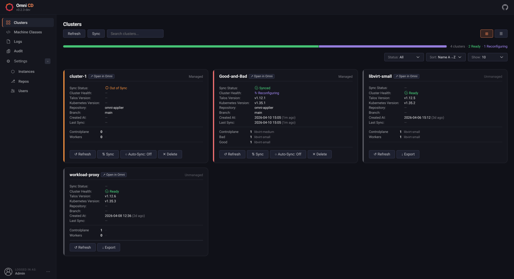

Card grid showing one card per cluster with:
- The cluster's labels from Omni (e.g. those set with `labels:` in the cluster template); Omni's own `omni.sidero.dev/*` labels are hidden
- Talos and Kubernetes versions
- Cluster, controlplane, API, etcd, and WireGuard health badges
- Controlplane and worker pool configuration
- Per-cluster **Refresh**, **Sync**, **Auto-Sync** toggle, and **Delete** actions

The toolbar supports:
- **Status** — filter by sync status or cluster health
- **Sort** — by name or last sync time
- **Show** — page size (5, 10, 15, 20, or All)
- **Grid / List** layout toggle

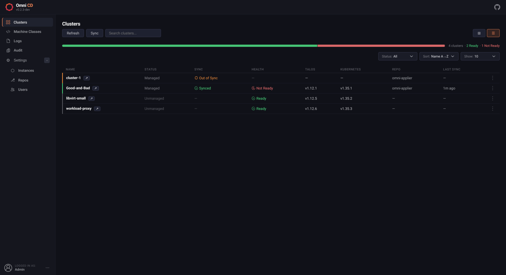

Click a cluster card to open the detail page.

### Cluster Detail

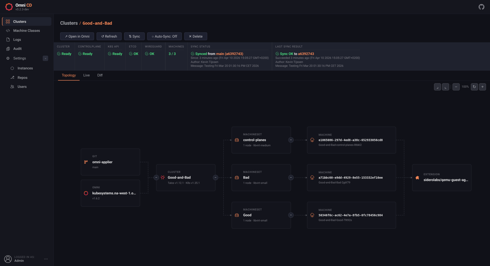

Four tabs:

| Tab | Contents |
|---|---|
| **Graph** | Visual DAG: Git → Omni → Cluster → MachineSets → Machines |
| **Live** | Current resource YAML as seen by Omni, with collapsible fold sections at every indentation level |
| **Diff** | Colour-coded diff between desired (Git) and live state |
| **Manifests** | Kubernetes manifest sync status from Omni — grouped by manifest group, showing mode (Full / One-Time), overall phase, and a per-resource table of Kind, Name, Namespace, and sync status |

The **Manifests** tab appears only when manifest data is available for the cluster. Manifest groups are collapsed by default; click a group row to expand it.

Clusters created outside of Git (unmanaged) show an **Export** button to download them as a YAML template.

---

## Machine Classes (`/machineclasses`)

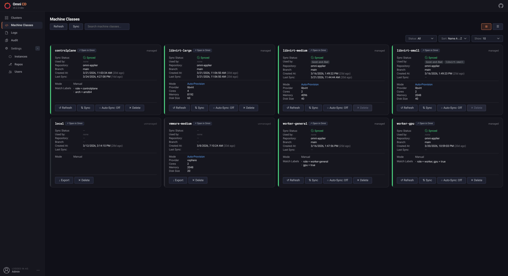

Card grid showing each MachineClass with its provisioning mode, resource settings, machine limit, and a live **Used by** list of clusters referencing it.

Each card has **Refresh**, **Sync**, **Auto-Sync** toggle, and **Delete** actions. Click a cluster chip to jump directly to that cluster.

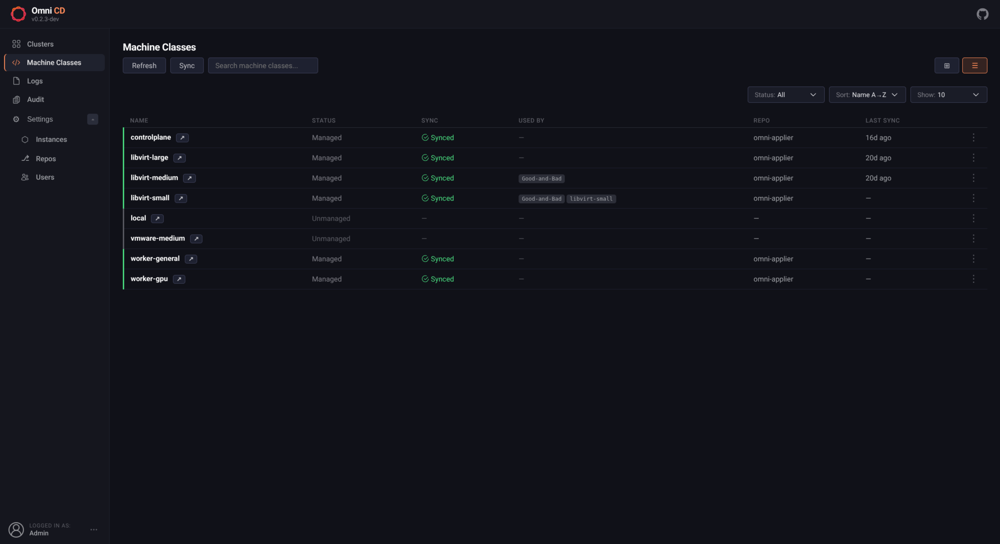

The toolbar supports the same Status, Sort, Show, and layout controls as the Clusters view.

---

## Instances (`/instances`)

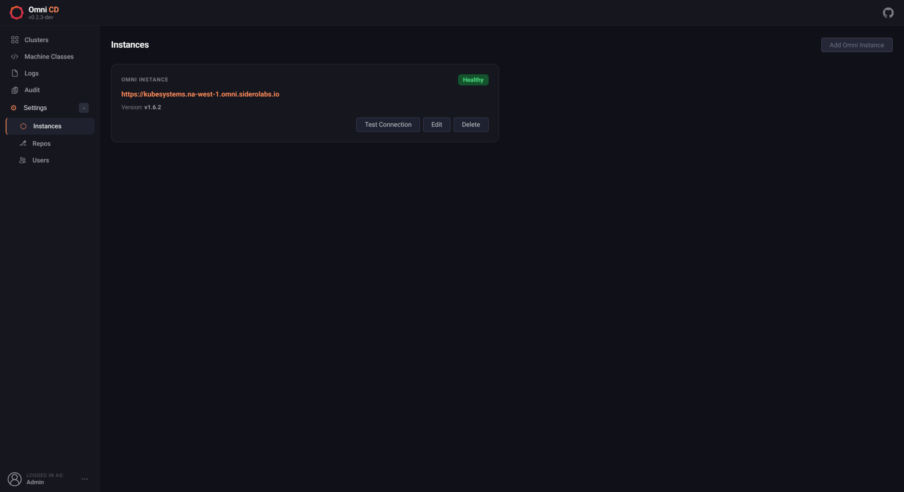

Manage the Omni endpoint and service account key. When credentials are provided via environment variables they are shown as read-only. When not set via ENV, use **Add Omni Instance** to configure the connection, or **Edit** / **Delete** an existing one. Changes take effect immediately.

---

## Repos (`/repos`)

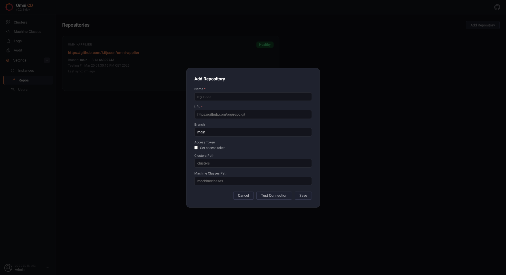

Add, edit, and remove Git repositories at runtime without restarting. Supports optional per-repo authentication tokens. Default paths are `clusters/` and `machine-classes/` if not specified.

---

## Maintenance Windows (`/maintenance-windows`)

Found under **Settings → Maintenance Windows**. A maintenance window restricts when Omni CD may change clusters automatically. It has a name, one weekly time range (for example *Tue and Thu 22:00–02:00*), and the clusters it applies to.

Click **Add Maintenance Window**, enter a name, choose the clusters, pick the days and the start and end time (24-hour). Clusters can be chosen two ways, and combined:

- **Select by label** — e.g. `env = production`. The window applies to every cluster with all of these labels, including clusters created or labelled later. Labels from Omni and from the `labels:` in the cluster template in Git both count, so a new cluster waits for the window even before it exists in Omni. The dialog previews which clusters match.
- **Tick clusters** individually. Clusters already matched by a label are shown ticked with *via label*.

Each window is shown as a card with its time range, its labels, the clusters it currently applies to, and an **Open** / **Closed** badge, and can be edited or removed there. The cluster detail page also shows the status, but windows are managed only from this page.

Times are in the server's timezone, shown at the top of the page. It is UTC unless the `TZ` environment variable is set on the container (e.g. `TZ=Europe/Amsterdam`). For different hours on different days, create several windows; a cluster can be in more than one and may be synced when any of them is open.

While auto-sync is on and the window is closed:

- Changes from Git are detected and shown as **Out of Sync**, but not applied.
- A cluster that is in Git but not yet in Omni stays **Missing** and is not created.
- A cluster removed from Git is not deleted.

When the window opens, Omni CD applies the pending changes within about 30 seconds, without waiting for a new commit. The manual **Sync** button, deleting a cluster from the UI, and removing a repository all ignore the window. If auto-sync is off, nothing is applied automatically whether or not the window is open.

Creating, editing and removing a window is recorded in the audit log (`maintenance-window-create`, `-update`, `-delete`).

---

## Users (`/users`)

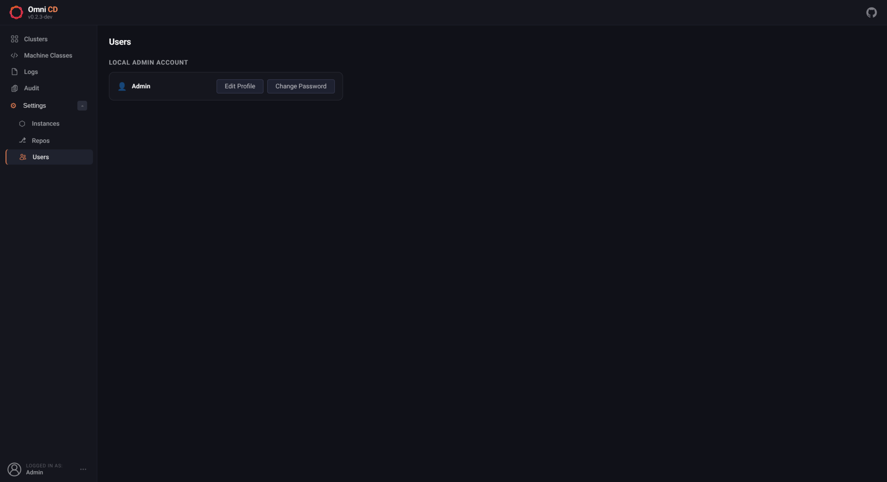

### Local Admin Account

- **Edit Profile** — update the display name
- **Change Password** — change your password (requires current password; enforces strength rules)

### SSO Users

When OIDC or Auth0 is enabled, all users who have logged in via SSO are listed here with their assigned role. Admins can change each user's role (`admin`, `viewer`, or `none`) or remove them.

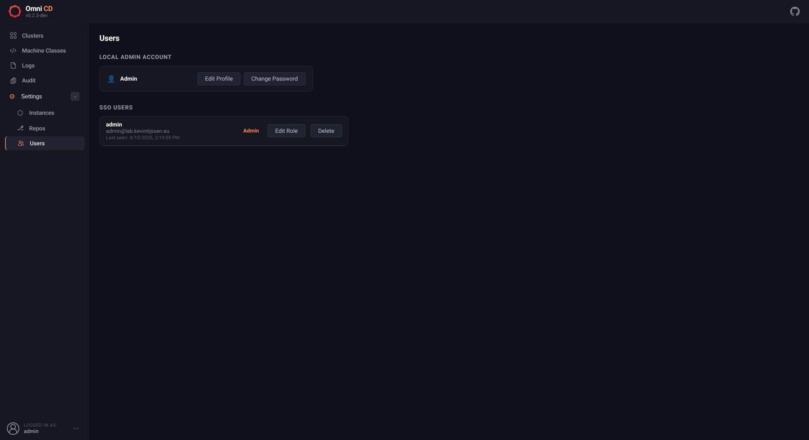

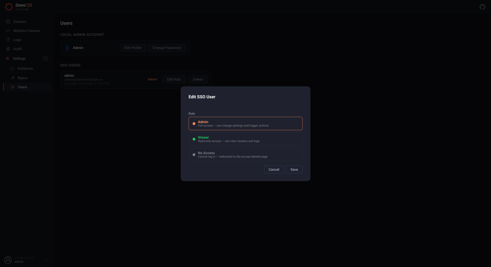

> This page is hidden and inaccessible when `AUTH_DISABLED=true`.

---

## Logs (`/logs`)

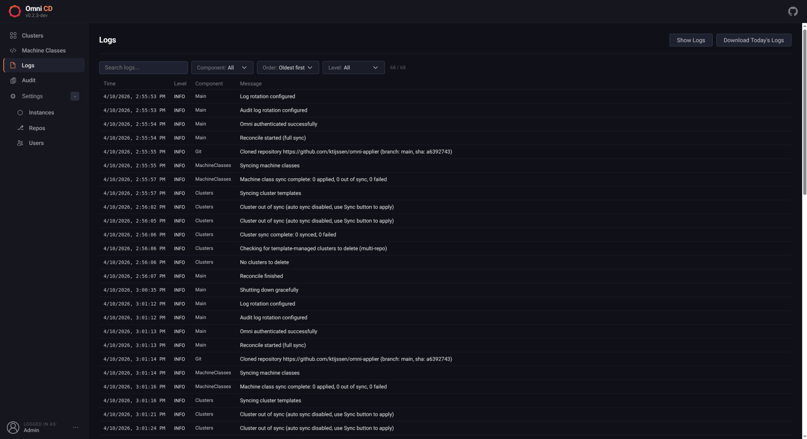

Reconciler log stream with filtering and export:

- **Level** — filter by ALL / DEBUG / INFO / WARN / ERROR
- **Component** — narrow to a specific component
- **Search** — filter by message content
- **Order** — oldest first (default) or newest first
- **Download Today's Logs** — download the current day's `.jsonlog` file
- **Show Logs** — browse all stored daily log files with individual download buttons

Logs are written to daily rotating `.jsonlog` files under `/data/logs/` and re-loaded on restart. Files older than `LOG_RETENTION_DAYS` days are deleted automatically.

---

## Audit Log (`/audit`)

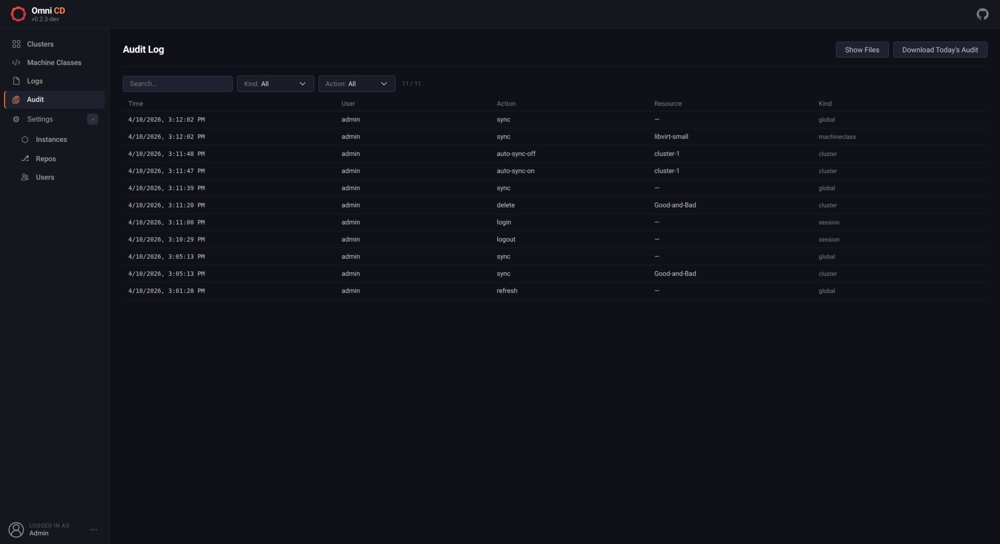

Records every user-initiated action:

| Column | Description |
|---|---|
| Time | UTC timestamp |
| User | Username or email of the actor |
| Action | What was done (e.g. `login`, `sync`, `delete`, `repo-add`) |
| Resource | The affected resource name |
| Kind | Resource type (`cluster`, `machineclass`, `repo`, `user`, `session`) |

Filters: **Kind**, **Action**, and free-text **Search**. Download options identical to the Logs page.

Audit files are stored under `/data/audit/` and kept for `AUDIT_RETENTION_DAYS` days (default: 30).
